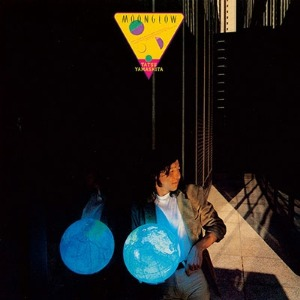

# Quentin Lintz

Software engineer and engineering leader, currently Tech Lead Manager at [Calendly](https://calendly.com/). Most of my time goes into thoughtful engineering, growing the people around me, and building teams I'd want to be on.

Outside of work I'm usually reading, playing guitar, or lifting. My listening lately leans heavily on Japanese City Pop and kayōkyoku.

[LinkedIn](https://www.linkedin.com/in/quentinlintz/) · [Goodreads](https://www.goodreads.com/user/show/160841838)

### Currently Exploring

- How to help a team do its best work as I grow from engineer into engineering leadership.
- What makes data systems reliable, with DDIA open beside a project in Go.
- How to turn a musical idea into a finished song.

### Languages

<picture>
  <source media="(prefers-color-scheme: dark)" srcset="./profile/top-langs-dark.svg">
  
</picture>

### Currently Reading

<!-- GOODREADS-CURRENTLY-READING:START -->
- [The Black Prince](https://www.goodreads.com/review/show/9046024131), Iris Murdoch
- [Designing Data\-Intensive Applications: The Big Ideas Behind Reliable, Scalable, and Maintainable Systems](https://www.goodreads.com/review/show/8889919757), Martin Kleppmann
<!-- GOODREADS-CURRENTLY-READING:END -->

### Recently Read

<!-- GOODREADS-READ:START -->
- [The Fisherman](https://www.goodreads.com/review/show/9030365344), John  Langan ★★★★☆ (4/5)
- [Show Your Work\!: 10 Ways to Share Your Creativity and Get Discovered](https://www.goodreads.com/review/show/9021062245), Austin Kleon ★★★★★ (5/5)
- [The Hobbit](https://www.goodreads.com/review/show/8980887441), J\.R\.R\. Tolkien ★★★☆☆ (3/5)
- [Martin Eden](https://www.goodreads.com/review/show/8980726689), Jack London ★☆☆☆☆ (1/5)
- [Piranesi](https://www.goodreads.com/review/show/8972224296), Susanna Clarke ★★☆☆☆ (2/5)
<!-- GOODREADS-READ:END -->

### On Repeat

[Moonglow by Tatsuro Yamashita](https://www.youtube.com/watch?v=sF0jiSSLfP4&list=PLHzplZi9LQ3Q) is my favorite of his albums. The long guitar solo in "Hot Shot" is unforgettable, and "愛を描いて (Let's Kiss The Sun)" never fails to lift my mood 🌞 Most of the lyrics were written by Minako Yoshida. She also does background vocals on many of his albums. Her own albums are well worth a listen, too.
